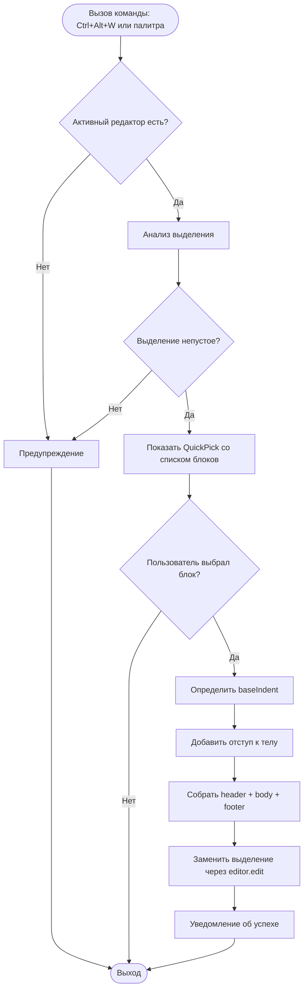

# Wrap Block

## Автор: Березин Александр Алексеевич, группа М3101
## IDE: Visual Studio Code
## Язык реализации: TypeScript

---

## Техническое задание

**Назначение:**
Плагин автоматически оборачивает выделенный фрагмент кода в конструкции `if`, `else`, `for` или `while`, сохраняя отступы выделенного фрагмента и добавляя один уровень отступа к телу блока. Ориентирован на **C++**-синтаксис.

**Функции:**

- **Обернуть в `if`** — оборачивает выделенный фрагмент в `if (condition) { ... }`.
- **Обернуть в `else`** — оборачивает выделенный фрагмент в `else { ... }`.
- **Обернуть в `for`** — оборачивает выделенный фрагмент в `for (int i = 0; i < N; i++) { ... }`.
- **Обернуть в `while`** — оборачивает выделенный фрагмент в `while (condition) { ... }`.

**Примечания:**

- Отступы выделенного фрагмента кода сохраняются.
- Тело блока получает один дополнительный уровень отступа (4 пробела).
- Пустые строки внутри выделения не получают дополнительный отступ.
- Работает только при наличии активного редактора и непустого выделения.
- Условия (`condition`, `N`) не подставляются автоматически — пользователь редактирует их самостоятельно.
- Плагин **не является сниппетом** — используется команда с логикой обработки выделения и структурой данных `Map`.

---

## Сочетания клавиш

| Команда | Горячие клавиши |
|---------|-----------------|
| Обернуть код в блок | `Ctrl+Alt+W` |


---

## Установка и запуск

1. Клонировать репозиторий:
   ```bash
   git clone git@github.com:Bany-cyber/wrap-block.git
   ```
2. Открыть папку `wrap-block` в VS Code как корневую.
3. Установить зависимости:
   ```bash
   npm install
   ```
4. Скомпилировать проект:
   ```bash
   npm run compile
   ```
5. Нажать **F5** — откроется новое окно **Extension Development Host**.
6. В новом окне открыть `.cpp`-файл, выделить код и вызвать команду:
   - через палитру команд: `Ctrl+Shift+P` → **«Обернуть код в блок»**;
   - или через горячие клавиши `Ctrl+Alt+W`.

---

## Примеры (C++)

### Пример 1. Обёртка в `if`

**Было (выделено):**
```cpp
int x = 5;
std::cout << x << std::endl;
```

**Стало (после выбора `if (...)`):**
```cpp
if (condition) {
    int x = 5;
    std::cout << x << std::endl;
}
```

> Остаётся заменить `condition` на своё условие, например `x > 0`.

---

### Пример 2. Обёртка в `else`

**Было (выделено):**
```cpp
std::cout << "negative" << std::endl;
```

**Стало (после выбора `else`):**
```cpp
else {
    std::cout << "negative" << std::endl;
}
```

---

### Пример 3. Обёртка в `for`

**Было (выделено):**
```cpp
std::cout << arr[i] << std::endl;
```

**Стало (после выбора `for (int i = 0; i < N; i++)`):**
```cpp
for (int i = 0; i < N; i++) {
    std::cout << arr[i] << std::endl;
}
```

> Перед использованием убедись, что переменная `N` определена выше (`const int N = ...;`).

---

### Пример 4. Обёртка в `while`

**Было (выделено):**
```cpp
std::cout << i << std::endl;
i++;
```

**Стало (после выбора `while`):**
```cpp
while (condition) {
    std::cout << i << std::endl;
    i++;
}
```

> Замени `condition` на, например, `i < 10`.

---

### Пример 5. Полный фрагмент программы

**До вызова плагина:**
```cpp
#include <iostream>

int main() {
    int arr[5] = {1, 2, 3, 4, 5};
    int N = 5;

    std::cout << arr[i] << std::endl;
    return 0;
}
```

**После обёртки строки `std::cout` в `for`:**
```cpp
#include <iostream>

int main() {
    int arr[5] = {1, 2, 3, 4, 5};
    int N = 5;

    for (int i = 0; i < N; i++) {
        std::cout << arr[i] << std::endl;
    }
    return 0;
}
```

---

## Архитектура

Плагин разделён на **три слоя** — каждая папка в `src/` отвечает за свою задачу:

```
src/
├── commands/
│   └── wrapCommand.ts     # Регистрация команды и UI (QuickPick)
├── models/
│   └── blockTemplate.ts   # Структуры данных: BlockTemplate, BLOCK_TEMPLATES
├── services/
│   └── wrapService.ts     # Логика обёртки выделенного текста
└── extension.ts           # Точка входа activate()
```

### Слой данных (`models/`)

- `interface BlockTemplate` — описывает один шаблон блока (`id`, `label`, `header`, `footer`, `description`).
- `Map<string, BlockTemplate> BLOCK_TEMPLATES` — реестр всех доступных блоков.

### Слой логики (`services/`)

- `wrapSelection(editor, template)` — читает выделение, определяет базовый отступ, добавляет один уровень отступа к телу, собирает `header + body + footer`, заменяет выделение через `editor.edit()`.

### Слой команд (`commands/`)

- `registerWrapCommand(context)` — регистрирует команду `wrapBlock.wrapWithBlock`, показывает `QuickPick` со списком блоков, вызывает `wrapSelection`.

### Точка входа (`extension.ts`)

- `activate(context)` — вызывает `registerWrapCommand(context)`.
- `deactivate()` — пустая, так как нет долгоживущих ресурсов.

**Ключевой принцип:** добавление нового блока (например, `do-while`) требует правки **только `Map`** в `models/blockTemplate.ts`. Слои логики и UI менять не нужно.

---

## Блок-схема работы алгоритма



---


## Ограничения

- Плагин **не анализирует синтаксис** — работает с выделенным текстом как со строкой.
- Условия блоков (`condition`, `N`) не подставляются автоматически.

---
